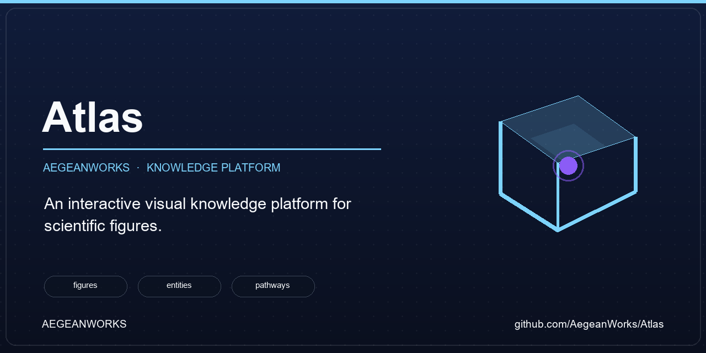
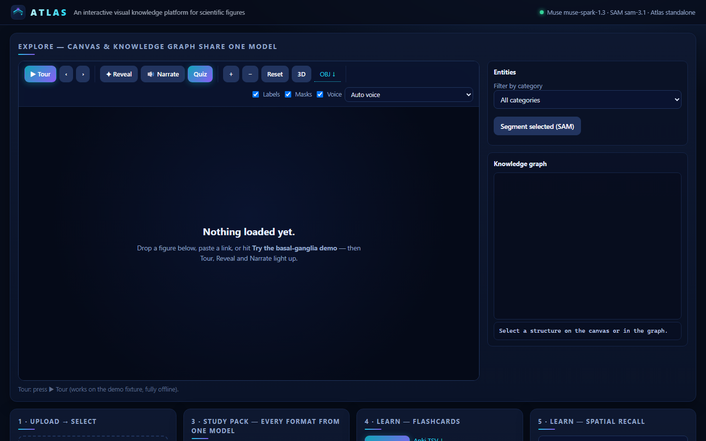
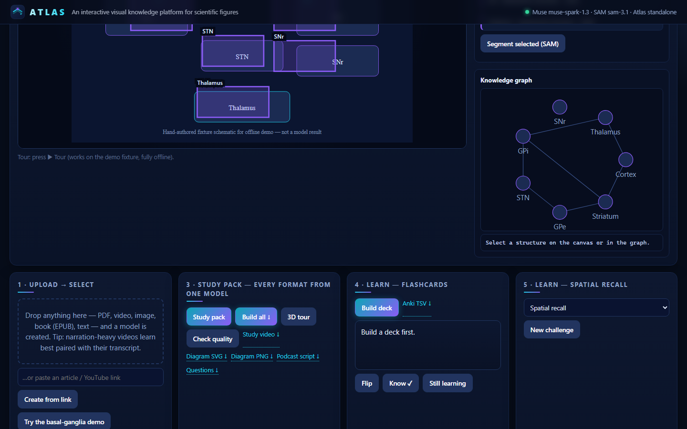

# Atlas 0.30.4

[](https://github.com/AegeanWorks/AIKit)

<!-- aegean:media:start -->
<p align="center"></p>
<!-- aegean:media:end -->

**An interactive visual knowledge platform for learning material — easy drag-and-drop.**

Drop any learning material — PDF, video, image, book (EPUB), text, or link.
Let multimodal AI understand it. Select an individual structure. Explore its
relationships directly on the original material. Learn by interacting with the
actual material. Figures are one format among many; everything provided becomes
learning material.

Atlas is fully standalone — no other project required. Visual AI: Meta Muse
Spark / Wonder + SAM 3.1 via Meta Model API.

## Quick start (one click)

Windows: run `install.ps1` once, then `start.ps1` (opens the workspace).
macOS/Linux: `./install.sh`, then `./start.sh`.

```powershell
powershell -ExecutionPolicy Bypass -File install.ps1
.\start.ps1   # serves http://127.0.0.1:8765, MODEL_API_KEY optional
```

Manual: `pip install -r requirements.txt`, then
`MODEL_API_KEY=... python -m atlas.app --port 8765`.

Bulk folders: `python -m atlas.cli batch <folder>` imports everything with an
offline report (proven on 81 real medical PDFs: 78 imported, 3 scanned-image
PDFs honestly refused with page counts). PDF pages render to figures with
optional `pip install PyMuPDF`; import reports page counts.

Drop anything on the drop zone — PDF, video, image, book (EPUB), text — or
paste an article/YouTube link: Atlas ingests it and creates a proper learning
model automatically (visual path for images/frames, text path with quoted
evidence for everything else). PDFs import with text; convert the target
page to an image for figure overlays. Video needs system `ffmpeg`; YouTube
needs public captions. No key? Everything except live Muse/SAM calls works;
see `docs/AI_CONTRACT.md` for headless/AI-agent use
(`python -m atlas.cli create figure.png`, `models`, `learn`).

No API key? The app, tests, and fixture demo all run offline; dropping any
file with no key builds an honest offline-extractive model (keyword frequency,
labelled `offline: true`) that drives graph, flashcards, study pack, and quality.
Live Muse/SAM calls refuse without a key instead of faking results.

```bash
python -m pytest tests -q -p no:cacheprovider
python demo/basal_ganglia_demo.py --fixture-only
```

## ⚡ 30-Second Cold-Start Quick Reference

- **Runtime Prerequisites**: Python 3.10+, `pip install -r requirements.txt`; optional system `ffmpeg` for video, `pip install PyMuPDF` for PDF rendering
- **Canonical Regression Shield Gate**:
  ```bash
  python -m pytest tests -q -p no:cacheprovider
  ```

### AIKit Commands (run from the AIKit workspace root)

| Role | Command |
|---|---|
| Status, task and gates | `python aikit.py status Atlas` |
| Delivery check (clean tree + map) | `python aikit.py check Atlas --strict` |
| Repair memory and map, then check | `python aikit.py fix Atlas` |
| Resume an interrupted task | `python aikit.py resume Atlas` |

## Upload → Select → Analyze → Explore → Learn

1. **Import** a PDF/PNG/JPEG (server-local path in MVP; original preserved with SHA + provenance). PDFs store text + provenance; convert the target page to PNG/JPEG for figure selection (the API returns a `figure_hint` for PDFs).
2. **Select** the figure with a manual normalized crop (`select_figure`); auto-detection is an explicit P1 stub.
3. **Analyze** with Muse Spark (`muse-spark-1.3` default, Wonder optional) — structured JSON on the 0–1000 grounding grid, validated into versioned `atlas.visual-knowledge/v1`.
4. **Segment** with SAM 3.1 (`sam-3.1`): short noun phrase + original crop → mask, else honest `bbox-fallback` overlay.
5. **Explore**: canvas and knowledge graph render the SAME analysis object; selecting either side highlights the other. Filter by entity category; drag-to-pan; zoom.
6. **Segment**: select a structure → "Segment selected (SAM)" cuts a mask with SAM 3.1 and attaches it to the entity (honest `bbox-fallback` when no mask decodes).
7. **Learn**: spatial recall, pathway tracing, visual identification, relationship recall — plus flashcard review (flip + score), Anki TSV export, and **on-figure quizzes** (a structure lights up, you answer right on the canvas).
8. **3D**: toggle the isometric stacked view (peel layers with the slider); download the model as OBJ for 3D tools and printing.
9. **Study pack**: one click builds an auto summary, a printable study diagram (SVG/PNG), a 3D layer tour, a two-host podcast script, a question bank worksheet, and a narrated-caption **study video (real MP4)** — all from the same model.
10. **Quality analysis**: every artifact is scored 0–100 with named checks (coverage, grounding, validity, duration) — in-app, via API, or `atlas.cli quality`.

## Independence

Atlas is a standalone product with its own entry point, config, persistence,
tests, docs, and versioning. Document-text routines live in-project
(`atlas/doc_text.py`, `atlas/text_backend.py`; originally adapted from
NeuralDeck, now Atlas-owned). There is no dependency on any other project.

`GET /api/integration` describes the backend. DOCX/PPTX need
`python-docx`/`python-pptx` (`pip install python-docx python-pptx`); PDF needs
`pypdf` (in requirements). Audio transcription is not bundled — supply a
transcript file instead.

## Configuration

Environment only: `MODEL_API_KEY` (or `META_API_KEY`), `ATLAS_MUSE_MODEL`,
`ATLAS_WONDER_MODEL`, `ATLAS_SAM_MODEL`, `ATLAS_BASE_URL`, `ATLAS_TIMEOUT_S`,
`ATLAS_MAX_RETRIES`, `ATLAS_DATA_DIR`. See `config.example.json`. Keys never
appear in logs — `AtlasConfig.redacted()` proves it.

Only the selected figure crop (+ optional caption note) is sent to Meta; never
the full document. See `docs/PRIVACY.md`.

## 📦 What's Inside

```text
Atlas/
├── README.md
├── CHANGELOG.md
├── LICENSE
├── LICENSES/
├── REUSE.toml
├── requirements.txt
├── pytest.ini
├── config.example.json
├── .gitignore
├── install.ps1
├── install.sh
├── install.bat
├── start.ps1
├── start.sh
├── start.bat
├── atlas/
├── static/
├── tests/
├── demo/
├── docs/
├── scripts/
└── assets/
```

## License

Free for personal use under the Aegean License 1.1 (AL-1.1); commercial use
requires the Aegean Commercial License (ACL-1.0). See LICENSE.

<!-- aegean:screenshots:start -->
## Screenshots

<a href="https://github.com/AegeanWorks/Atlas/commit/548eedc"></a>

<a href="https://github.com/AegeanWorks/Atlas/commit/548eedc"></a>

*commit `548eedc` · 2026-11-03 · viewport 1440x900 · empty workspace plus fixture figure (ADR-004)*
<!-- aegean:screenshots:end -->
